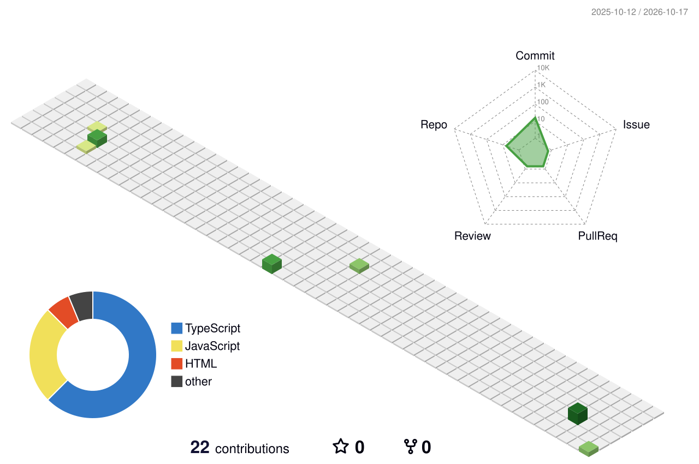

# Saksham Vij

<picture>
  <source media="(prefers-color-scheme: dark)" srcset="https://readme-typing-svg.demolab.com?font=Fira+Code&size=22&duration=3200&pause=1400&color=58A6FF&center=true&vCenter=true&width=640&height=48&lines=Full-Stack+Developer;Cloud+%26+DevOps+Builder;B.Tech+CSE+%40+Bennett+University">
  <source media="(prefers-color-scheme: light)" srcset="https://readme-typing-svg.demolab.com?font=Fira+Code&size=22&duration=3200&pause=1400&color=0969DA&center=true&vCenter=true&width=640&height=48&lines=Full-Stack+Developer;Cloud+%26+DevOps+Builder;B.Tech+CSE+%40+Bennett+University">
  
</picture>

Computer science undergraduate building full-stack apps and the cloud tooling that runs them. 
Currently building **A Cloud for Small Software**, a platform that deploys an imported app as a Docker container.

 

<picture>
  <source media="(prefers-color-scheme: dark)" srcset="https://skillicons.dev/icons?i=py,ts,react,nextjs,tailwind,nodejs,postgres,docker,kubernetes,githubactions,aws,git&perline=12&theme=dark">
  <source media="(prefers-color-scheme: light)" srcset="https://skillicons.dev/icons?i=py,ts,react,nextjs,tailwind,nodejs,postgres,docker,kubernetes,githubactions,aws,git&perline=12&theme=light">
  
</picture>

Exploring: FastAPI · Celery · Redis · AI agents

---

### Featured work

**A Cloud for Small Software** · *in progress, private repository*
A simplified cloud platform for students and developers to deploy small apps without managing infrastructure. Import an app and it detects the runtime, framework, ports, dependencies and environment variables, then deploys it as a Docker container. A GitHub Actions pipeline runs PostgreSQL-backed tests, an API health check, a real Docker deployment test, and a type-checked, linted frontend build.
`Next.js` `React` `TypeScript` `Node.js` `PostgreSQL` `Docker` `Kubernetes` `GitHub Actions`

**[Bitcoin Script Execution Simulator](https://github.com/saksham-source/Bitcoin-Script-Like-Execution-Simulator)**
An interactive, educational simulator of stack-based Bitcoin Script, built for Blockchain Lab evaluation. It evaluates opcodes step by step while tracking stack state, and accepts a spend only when the final stack satisfies the locking script. Backed by 34 passing Vitest tests.
`TypeScript` `Next.js` `Tailwind CSS` `Vitest`

---

### Activity

<picture>
  <source media="(prefers-color-scheme: dark)" srcset="./profile-3d-contrib/profile-night-green.svg">
  <source media="(prefers-color-scheme: light)" srcset="./profile-3d-contrib/profile-green.svg">
  
</picture>

  

<b>More about me</b>

 

- 🎓 B.Tech in Computer Science and Engineering, Bennett University (2024 – 2028), CGPA 8.0
- 🧩 LeetCode: 220+ problems solved, contest rating 1427 over 5 contests, longest streak of 111 days
- 🏆 Team Leader, Smart India Hackathon 2025 (6-member team), plus 5+ hackathons
- 📜 HackerRank Problem Solving (Intermediate), and Google's *Computer Networking* and *Operating Systems* courses on Coursera
- 🤝 Batch Representative for 120 students; marketing and management team at the GeeksforGeeks Student Chapter

Open to Software Engineering, Cloud, DevOps and Full-Stack internships · <a href="mailto:sakshamvij2005@gmail.com">say hi</a>

